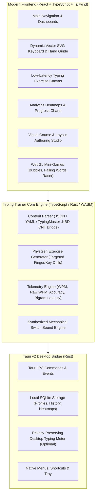

# Typing Trainer: Comprehensive Architectural Analysis & Open-Source Engineering Blueprint

**Project Name:** Typing Trainer  
**Target Goal:** Free, Open-Source, Modern, Cross-Platform Typing Training Suite (Windows, macOS, Linux, Web)  
**Analyzed System:** TypingMaster 12 (Cloud Kayak Labs, Inc. / TypingMaster Inc.)  
**Workspace Path:** `D:\TypingTrainer`  
**Date:** November 2026  

---

## Table of Contents
1. [Executive Summary](#1-executive-summary)
2. [Deep-Dive Reverse Engineering Analysis of TypingMaster 12](#2-deep-dive-reverse-engineering-analysis-of-typingmaster-12)
   - [2.1 Architectural Breakdown & Binary Forensics](#21-architectural-breakdown--binary-forensics)
   - [2.2 Directory Structure & Asset Inventory](#22-directory-structure--asset-inventory)
   - [2.3 Proprietary File Formats Reverse-Engineered](#23-proprietary-file-formats-reverse-engineered)
   - [2.4 TypingMaster 12: Strengths & Pedagogical Merits](#24-typingmaster-12-strengths--pedagogical-merits)
   - [2.5 TypingMaster 12: Limitations, Flaws & Bottlenecks](#25-typingmaster-12-limitations-flaws--bottlenecks)
3. [Typing Trainer: Strategic Vision & Requirements](#3-typing-trainer-strategic-vision--requirements)
   - [3.1 Core Principles](#31-core-principles)
   - [3.2 Multi-Platform Support Matrix](#32-multi-platform-support-matrix)
4. [Recommended Technology Stack & System Architecture](#4-recommended-technology-stack--system-architecture)
   - [4.1 Architecture Comparison (Tauri v2 vs. Flutter vs. Electron)](#41-architecture-comparison-tauri-v2-vs-flutter-vs-electron)
   - [4.2 Selected Architecture: Tauri v2 + Rust + React/TypeScript](#42-selected-architecture-tauri-v2--rust--reacttypescript)
   - [4.3 System Component Architecture Diagram](#43-system-component-architecture-diagram)
5. [Open Content Specifications & Migration Bridge](#5-open-content-specifications--migration-bridge)
   - [5.1 Modern Keyboard Layout Schema (JSON/YAML)](#51-modern-keyboard-layout-schema-jsonyaml)
   - [5.2 Modern Lesson & Course Schema](#52-modern-lesson--course-schema)
   - [5.3 TypingMaster Legacy Importer Bridge](#53-typingmaster-legacy-importer-bridge)
6. [Next-Gen Features to Surpass TypingMaster 12](#6-next-gen-features-to-surpass-typingmaster-12)
   - [6.1 Real-Time SVG Vector Keyboard with Hand Visualizer](#61-real-time-svg-vector-keyboard-with-hand-visualizer)
   - [6.2 Adaptive Drill Engine & Latency Heatmap](#62-adaptive-drill-engine--latency-heatmap)
   - [6.3 Modern Gamification Suite (WebGL / HTML5 Canvas)](#63-modern-gamification-suite-webgl--html5-canvas)
   - [6.4 Privacy-Preserving Typing Meter (Optional Daemon)](#64-privacy-preserving-typing-meter-optional-daemon)
   - [6.5 Built-In Visual Course & Material Editor](#65-built-in-visual-course--material-editor)
7. [Open-Source Project Roadmap & Milestone Execution Plan](#7-open-source-project-roadmap--milestone-execution-plan)
   - [Phase 1: Core Engine & Data Models (Weeks 1-3)](#phase-1-core-engine--data-models-weeks-1-3)
   - [Phase 2: Modern Keyboard Visualizer & Tutor Experience (Weeks 4-6)](#phase-2-modern-keyboard-visualizer--tutor-experience-weeks-4-6)
   - [Phase 3: Gamification & Modern Course Editor (Weeks 7-9)](#phase-3-gamification--modern-course-editor-weeks-7-9)
   - [Phase 4: Cross-Platform Packaging & Community Launch (Weeks 10-12)](#phase-4-cross-platform-packaging--community-launch-weeks-10-12)
8. [Conclusion & Next Immediate Steps](#8-conclusion--next-immediate-steps)

---

## 1. Executive Summary

TypingMaster has been an industry standard for commercial touch typing instruction for over two decades. However, **TypingMaster 12** remains tethered to a legacy 32-bit Win32 codebase dating back to the early 2000s. Its closed-source licensing model, proprietary data formats, archaic UI scaling, lack of native support for macOS and Linux, and invasive keylogger-style background monitor make it ripe for disruption.

The proposed initiative, **Typing Trainer**, is envisioned as a **next-generation, 100% free and open-source (FOSS) touch typing software suite** engineered from the ground up for modern operating systems: **Windows 10/11, macOS (Apple Silicon & Intel), Linux (Flatpak, AppImage, deb/rpm), and modern Web Browsers (WebAssembly/PWA)**.

This report delivers a full reverse engineering analysis of the installed TypingMaster 12 directory at `D:\TypingTrainer\TypingMaster12` and establishes the complete engineering blueprint for building **Typing Trainer**.

---

## 2. Deep-Dive Reverse Engineering Analysis of TypingMaster 12

### 2.1 Architectural Breakdown & Binary Forensics

Inspection of `D:\TypingTrainer\TypingMaster12` reveals a classic monolithic 32-bit (x86) Windows application written in C/C++ using the native Win32 API and GDI (Graphics Device Interface) rendering:

```
TypingMaster 12 Application Footprint:
├── Total Files: 4,097
├── Total Disk Size: ~28.3 MB
├── Target Architecture: Windows x86 (32-bit PE32)
├── Primary Executables:
│   ├── TypingMaster.exe   (4,189,976 bytes) - Main application / tutor UI
│   ├── kboost.exe         (1,382,968 bytes) - "Typing Meter" background monitoring daemon
│   ├── tmeditor.exe       (8,258,560 bytes) - "TMEditor" material & course editor
│   ├── CloseTypingMeter.exe (37,448 bytes)  - Helper utility to terminate kboost.exe
│   └── unins000.exe       (3,752,504 bytes) - Inno Setup uninstaller
```

#### Binary Import & API Inspection
- **Rendering & GUI**: Employs legacy GDI and GDI+ APIs (`msimg32.dll`: `TransparentBlt`, `AlphaBlend`, `GradientFill`; `user32.dll`, `uxtheme.dll`). It lacks modern GPU hardware acceleration (DirectX/Vulkan/Metal).
- **DPI Handling**: Employs retrofitted Per-Monitor DPI v2 calls (`GetDpiForWindow`, `AdjustWindowRectExForDpi`), but still renders static, non-scalable bitmap resources (`.bmp`, `.gif`).
- **Codebase Origins**: Binary strings reveal configuration dating back to `Typing Master 10 6.21` and `TMPRO 7.00.722` (December 2002), confirming that version 12 is an incremental wrapper around a 24-year-old C++ engine.

### 2.2 Directory Structure & Asset Inventory

The file system organization reflects a file-based content architecture:

```
D:\TypingTrainer\TypingMaster12\
├── keyboards\     (56 keyboard layout definitions, e.g. 101usa.kbd, dvorak.kbd, colemak.kbd)
├── lessons\       (Hundreds of course files: .cnt, .hdr, .wzd, .txt, .vcb)
├── texts\         (Typing test source texts: .exm metadata and .exi index files)
├── manual\        (Static HTML/CSS user guides and offline documentation)
├── *.bmp, *.gif   (Raster assets for UI controls, keyboard diagrams, and mini-games)
├── *.wav          (16-bit PCM sound effects: Click.wav, Error.wav, Theend.wav)
└── language.*     (Flat key-value dictionary localization files for 13+ languages)
```

### 2.3 Proprietary File Formats Reverse-Engineered

Our analysis successfully decoded all core file formats utilized by TypingMaster 12:

#### 1. Keyboard Layout Specification (`*.kbd`)
Keyboards are defined as plain-text geometry files with custom token delimiters:
- **Header**: Version, material base (`MaterialBased;qwerty`), Windows layout hex code (`layoutcode;00000409`), HomeRow string (`HomeRow;asdfjkl%;`), default key dimensions (`DefaultSize;32;34`), font sizing.
- **Key Definition Syntax**:
  ```text
  Key;finger;x;y;width;height;style;normal_char;shift_char;altgr_char
  ```
  - `finger`: 1 through 8 (corresponding to Left Pinky -> Right Pinky; thumbs handle Space).
  - `x, y`: Coordinate offsets (`+1`, `0`, or absolute pixel positions).
  - `style`: Flags such as `n` (nipple/tactile bump on 'F' and 'J'), `d` (dark), `i` (invisible).
  - *Example*: `Key;1;1;1;-;-;-;`;~` defines the tilde/backtick key for left pinky.

#### 2. Course & Curriculum Definition (`*.cnt`, `*.wzd`, `*.hdr`)
Courses use a hierarchical structured text format:
- **Course Header**: Metadata directives (`$description=...`, `$chapters=14`, `$durationlist=30`, `keyboard=us.kbd`).
- **Block Structure**: Nested `begin chapter ... end chapter` and `begin exercise ... end exercise`.
- **Event Dispatcher**:
  - `EVENT=MESSAGE;...`: Pedagogical tips, hand placement instructions, accompanying image.
  - `EVENT=KEYINTRO;...`: Introducing new keys with visual target prompts.
  - `EVENT=WORD2;duration;PHYSGEN:fingers:4,5`: Algorithmic text generator restricted to specific trained fingers.
  - `EVENT=KEY2;duration;PHYSGEN:fingers:4|row:3`: Row-isolated finger drills.

#### 3. Typing Tests (`*.exi` and `*.exm`)
- `*.exi`: INI-style metadata declaring `name=Astronauts`, `category=intermediate`, `encode=utf8`, `language=eng`.
- `*.exm`: Plain text file containing the actual paragraphs for typing evaluations.

#### 4. Vocabulary Lists (`*.vcb.*`)
- Sliced text lists classified by category (`animals.vcb.eng`, `cars.vcb.eng`, `easy words.vcb.eng`) used to supply words to typing mini-games (Bubbles, WordTris).

#### 5. Localization Dictionaries (`language.*`)
- Numeric ID mappings (`0=language.eng`, `1=Typing Master`, `202=&WPM (words/min)`). Lines starting with `//` are comments; whitespace escapes use `\+`.

---

### 2.4 TypingMaster 12: Strengths & Pedagogical Merits

1. **Structured Learning Progression**: Proven progression model starting from the Home Row (ASDF JKL;) and methodically branching outwards to index reaching, upper row, lower row, numbers, and symbols.
2. **Dynamic Vocabulary Generation (`PHYSGEN`)**: Exercises are procedurally generated based on known characters and specific finger constraints, preventing users from encountering untrained keys prematurely.
3. **Multi-Layout Support**: Broad out-of-the-box catalog of layouts (QWERTY, QWERTZ, AZERTY, Dvorak, Colemak, Devanagari, Kannada, Vietnamese).
4. **Gamified Practice**: Integrated mini-games (Bubbles, WordTris, Pipe Game) relieve fatigue and reinforce motor memory.
5. **Real-World Typing Meter Concept**: The concept of analyzing background typing habits to diagnose problematic bigrams and recurring mistakes is valuable.

---

### 2.5 TypingMaster 12: Limitations, Flaws & Bottlenecks

| Problem Area | TypingMaster 12 Implementation | Critical Impact / Why It Fails Today |
| :--- | :--- | :--- |
| **Platform Lock-In** | Win32 x86 binary with hardcoded Windows APIs. | Excludes macOS (Apple Silicon/Intel), Linux, Chromebooks, and Web. Wine emulation has known window-jumping and DPI bugs. |
| **Graphics & Rendering** | 1990s-era static GDI bitmaps (`.bmp`, `.gif`) at fixed resolutions. | Blurry on 2K/4K/Retina displays; visually dated; cannot adapt smoothly to responsive window resizing. |
| **Typing Meter Architecture** | `kboost.exe` runs a persistent low-level Windows keyboard hook (`SetWindowsHookEx`). | **Flagged as a keylogger by modern Antivirus software.** Strictly blocked by macOS security sandboxes (Input Monitoring) and Linux Wayland compositors. |
| **Licensing & Community** | Proprietary commercial software with license keys, hardware ID lock, and trial limits. | High friction for schools, developing countries, and individual learners; zero open-source contributions. |
| **Telemetry & Analytics** | Rudimentary gross WPM, net WPM, and static error counts. | Lacks fine-grained latency metrics (key-press intervals in milliseconds), burst speed tracking, and finger fatigue heatmaps. |
| **Data Formats** | Custom, fragmented `.cnt`, `.wzd`, `.exi`, `.exm` files. | Inflexible; cannot be easily parsed, modified, or consumed by modern web, cloud, or mobile environments. |

---

## 3. Typing Trainer: Strategic Vision & Requirements

### 3.1 Core Principles
1. **100% Free & Open Source (FOSS)**: Permissively licensed under MIT or Apache 2.0. No paywalls, no trial limits, no telemetry tracking.
2. **Truly Native Cross-Platform**: Identical feature parity across Windows, macOS, Linux, and modern Web browsers.
3. **Ergonomic & Modern Aesthetics**: Clean, distraction-free UI, fluid 60/120 FPS SVG/Canvas keyboard visualizer, dark and light themes (Catppuccin, Nord, Dracula, GitHub Dark/Light).
4. **Pedagogical Excellence + Modern Ergonomics**: Progressive finger-by-finger curriculum, support for split keyboards (Ergodox, Alice, Ortholinear), tactile mechanical switch audio synthesis.
5. **Privacy-Preserving**: All data remains strictly local in SQLite / IndexedDB. Zero telemetry sent to external servers.

### 3.2 Multi-Platform Support Matrix

```
┌────────────────────────────────────────────────────────────────────────┐
│                        Typing Trainer Core                             │
│                  (Shared Rust Engine / WebAssembly)                    │
└───────────────────────────────────┬────────────────────────────────────┘
                                    │
         ┌──────────────────────────┼──────────────────────────┐
         ▼                          ▼                          ▼
┌──────────────────┐       ┌──────────────────┐       ┌──────────────────┐
│  Desktop App     │       │   Web / PWA      │       │ Optional Sidecar │
│ (Tauri v2 App)   │       │ (Static / WASM)  │       │ (Typing Meter)   │
├──────────────────┤       ├──────────────────┤       ├──────────────────┤
│ • Windows (MSI)  │       │ • Any browser    │       │ • Local SQLite   │
│ • macOS (DMG/App)│       │ • Zero install   │       │ • Sandboxed      │
│ • Linux (Flatpak/│       │ • Offline PWA    │       │ • Explicit opt-in│
│   AppImage/deb)  │       │                  │       │                  │
└──────────────────┘       └──────────────────┘       └──────────────────┘
```

---

## 4. Recommended Technology Stack & System Architecture

### 4.1 Architecture Comparison (Tauri v2 vs. Flutter vs. Electron)

| Metric | Tauri v2 + Rust + Web UI *(Recommended)* | Flutter (Dart) | Electron (Node.js + Chromium) |
| :--- | :--- | :--- | :--- |
| **Installer Size** | **~8 MB - 15 MB** (Ultra-compact) | ~40 MB - 60 MB | ~120 MB - 180 MB (Bloated) |
| **RAM Consumption** | **~30 MB - 50 MB** | ~80 MB - 120 MB | ~200 MB - 400 MB |
| **Keyboard Event Latency** | **< 1ms** (Rust native raw input) | ~3ms - 6ms | ~8ms - 16ms (Chromium event loop) |
| **Cross-Platform** | Windows, macOS, Linux, iOS, Android, Web (WASM) | Windows, macOS, Linux, Mobile, Web | Windows, macOS, Linux (No mobile/pure web) |
| **Web Parity** | 100% (Frontend compiles to pure Web/WASM) | Web version often feels sluggish/canvas-heavy | Requires rewrite for web |
| **Security & Permissions** | Hardened Rust backend, fine-grained IPC permissions | Sandboxed Dart runtime | Large attack surface (Node integration) |

### 4.2 Selected Architecture: Tauri v2 + Rust + React/TypeScript

1. **Native Shell & System Integration (Rust + Tauri v2)**:
   - High-precision keystroke timing via `std::time::Instant` (sub-millisecond accuracy).
   - Local database persistence via SQLite (`rusqlite`).
   - Cross-platform packaging: Windows `.msi` / `.exe`, macOS `.dmg` (Universal binary for M1/M2/M3 and Intel x64), Linux `.AppImage`, `.flatpak`, `.deb`.
2. **Frontend UI & Presentation Layer**:
   - **Framework**: React 19 / TypeScript / Vite.
   - **Styling**: Tailwind CSS + Radix UI / Shadcn UI for accessible, modern components.
   - **Keyboard Rendering**: Dynamic SVG & HTML5 Canvas for real-time key depressions, finger trail animations, and heatmap overlays.
   - **Audio Engine**: Web Audio API synthesizing authentic mechanical switch acoustics (Cherry MX Blue, Brown, Red, Topre, Model M).
3. **Web / WebAssembly Build**:
   - Compiles effortlessly into a browser-executable Progressive Web App (PWA) hosted on GitHub Pages or Vercel, allowing users to train instantly without installation.

### 4.3 System Component Architecture Diagram



---

## 5. Open Content Specifications & Migration Bridge

To eliminate proprietary file fragmentation, Typing Trainer uses clean, human-readable, and machine-validated **JSON / YAML** specifications.

### 5.1 Modern Keyboard Layout Schema (JSON/YAML)

File: `keyboards/en-us-qwerty.json`
```json
{
  "id": "en-us-qwerty",
  "name": "US English QWERTY",
  "language": "en",
  "standard": "ANSI-104",
  "homeRow": ["a", "s", "d", "f", "j", "k", "l", ";"],
  "fingerAssignments": {
    "1": ["`", "1", "q", "a", "z"],
    "2": ["2", "w", "s", "x"],
    "3": ["3", "e", "d", "c"],
    "4": ["4", "5", "r", "t", "f", "g", "v", "b"],
    "5": ["6", "7", "y", "u", "h", "j", "n", "m"],
    "6": ["8", "i", "k", ","],
    "7": ["9", "o", "l", "."],
    "8": ["0", "-", "=", "p", "[", "]", "'", "/", "Enter", "Backspace"],
    "thumb": ["Space"]
  },
  "keys": [
    { "code": "KeyQ", "labels": ["q", "Q"], "finger": 1, "row": 1, "col": 1, "width": 1.0 },
    { "code": "KeyF", "labels": ["f", "F"], "finger": 4, "row": 2, "col": 4, "width": 1.0, "hasNipple": true },
    { "code": "KeyJ", "labels": ["j", "J"], "finger": 5, "row": 2, "col": 7, "width": 1.0, "hasNipple": true }
  ]
}
```

### 5.2 Modern Lesson & Course Schema

File: `courses/touch-typing-fundamentals.json`
```json
{
  "id": "touch-typing-fundamentals",
  "title": "Touch Typing Fundamentals",
  "description": "Master touch typing from the ground up using systematic finger muscle memory.",
  "targetLayout": "en-us-qwerty",
  "chapters": [
    {
      "id": "chapter-01",
      "title": "Day 1: Home Row Index Keys (F & J)",
      "targetKeys": ["f", "j", "Space"],
      "exercises": [
        {
          "type": "introduction",
          "title": "Welcome to the Home Row",
          "instructions": "Place your left index finger on F and right index finger on J. Feel the small bumps."
        },
        {
          "type": "finger-drill",
          "title": "Index Finger Pairs",
          "targetFingers": [4, 5],
          "durationSeconds": 120,
          "minAccuracy": 95,
          "content": "ff jj fj jf ff jj fjf jfj fff jjj"
        },
        {
          "type": "procedural-words",
          "title": "Word Generation",
          "durationSeconds": 180,
          "algorithm": "physgen",
          "allowedKeys": ["f", "j", "d", "k"]
        }
      ]
    }
  ]
}
```

### 5.3 TypingMaster Legacy Importer Bridge

To ensure immediate backward compatibility and give users access to TypingMaster's comprehensive library of 56 keyboards and hundreds of lessons, Typing Trainer will include a built-in **Migration Utility**:
- **KbdConverter**: Reads `.kbd` files, parses coordinate offsets and finger numbers, and exports standard SVG geometry.
- **CntConverter**: Reads `.cnt` chapters and exercises, translating `EVENT=KEYINTRO`, `EVENT=WORD2`, and `PHYSGEN` parameters into standard course JSON.
- **ExmConverter**: Converts `.exi` and `.exm` text pairs into standardized Markdown test files with YAML frontmatter.

---

## 6. Next-Gen Features to Surpass TypingMaster 12

### 6.1 Real-Time SVG Vector Keyboard with Hand Visualizer
- **Resolution-Independent**: Perfectly sharp at 1080p, 4K, 8K, and on mobile screens.
- **Visual Hand Anatomy Guide**: Translucent 2D hands positioned above the keyboard illustrating finger movement, ideal for children and beginning typists.
- **Custom Hardware Layouts**: Supports standard 100%, Tenkeyless (TKL), 75%, 65%, 60%, and Ergonomic Split layouts (e.g. Dactyl ManuForm, Ergodox EZ).

### 6.2 Adaptive Drill Engine & Latency Heatmap
- **Beyond Simple Accuracy**: Tracks the **Inter-Key Latency (IKL)** in milliseconds for every pair of letters (bigrams like `th`, `er`, `st`, `in`).
- **Bottleneck Detection**: Identifies keys where the user does not necessarily press the wrong letter, but experiences hesitation or muscle friction (e.g., ring finger reaching for 'O' taking 350ms vs. home keys taking 120ms).
- **Auto-Generated Drills**: The application dynamically builds custom 2-minute drills consisting strictly of the user's top 10 weakest bigrams.

### 6.3 Modern Gamification Suite (WebGL / HTML5 Canvas)
- **Word Fall (Remake of WordTris)**: Smooth falling blocks with particle explosions on successful words.
- **Bubble Pop 2.0**: Floating letter bubbles with responsive physics and musical tones.
- **Speed Racer**: Real-time racing against AI ghosts or local peer-to-peer multiplayer via WebRTC.
- **Rhythm Typist**: Keystrokes synced to lo-fi beats or electronic soundtrack tempos.

### 6.4 Privacy-Preserving Typing Meter (Optional Daemon)
- **Local & Transparent**: Unlike TypingMaster's closed `kboost.exe`, Typing Trainer's background meter is strictly opt-in, open-source, and stores data in a local SQLite file (`~/.typing-trainer/meter.db`).
- **Zero Raw Keystroke Logging**: The daemon never records raw textual strings or passwords. It exclusively tallies aggregate bigram transition times and error percentages, fully respecting user privacy.

### 6.5 Built-In Visual Course & Material Editor
- Replaces the archaic `tmeditor.exe` with a modern, in-browser drag-and-drop course creator.
- Export and import courses with a single click, or subscribe to community course repositories on GitHub.

---

## 7. Open-Source Project Roadmap & Milestone Execution Plan

```
┌────────────────────────────────────────────────────────────────────────┐
│                        Execution Roadmap Timeline                      │
└────────────────────────────────────────────────────────────────────────┘

Weeks 1-3  [Phase 1]: Core Typing Engine & Data Architecture
                      ├── Rust/TypeScript Core Typing Engine
                      ├── Modern Schema Definitions (JSON/YAML)
                      └── TypingMaster Legacy Importer Bridge (.kbd, .cnt)

Weeks 4-6  [Phase 2]: Vector Keyboard, Hands & Tutor Flow
                      ├── SVG Responsive Virtual Keyboard
                      ├── Visual Hands / Ergonomic Guides
                      └── Progressive Lesson Runner & Switch Sound Synthesis

Weeks 7-9  [Phase 3]: Analytics, Heatmaps & Gamification Suite
                      ├── Bigram Latency Engine & Heatmaps
                      ├── Modernized Mini-Games (Bubbles 2.0, Word Fall)
                      └── Visual In-App Course & Test Editor

Weeks 10-12[Phase 4]: Tauri Packaging, Web Deployment & Launch
                      ├── Cross-Platform Packaging (Win, Mac, Linux)
                      ├── WebAssembly / PWA Zero-Install Deployment
                      └── GitHub Open-Source Community Launch
```

### Phase 1: Core Engine & Data Models (Weeks 1-3)
- Initialize Git repository at `D:\TypingTrainer`.
- Build the core typing evaluator (`TypingEngine`): keystroke validation, gross WPM, net WPM, accuracy %, raw WPM, CPM, and error delta tracking.
- Implement the legacy file parser to convert `D:\TypingTrainer\TypingMaster12\keyboards\*.kbd` and `lessons\*.cnt` into modern JSON.

### Phase 2: Modern Keyboard Visualizer & Tutor Experience (Weeks 4-6)
- Develop the dynamic SVG keyboard component supporting ANSI, ISO, and JIS layouts.
- Integrate animated hand placement overlays showing active finger targets.
- Implement the Web Audio mechanical switch sound generator.
- Build the core lesson flow: Introduction -> Finger Drills -> Dynamic Sentence Drills -> Results Screen.

### Phase 3: Gamification & Modern Course Editor (Weeks 7-9)
- Implement interactive mini-games in HTML5 Canvas.
- Build the analytics dashboard: WPM history graphs, finger fatigue heatmaps, difficult key indicators.
- Construct the visual WYSIWYG lesson editor for custom curriculum design.

### Phase 4: Cross-Platform Packaging & Community Launch (Weeks 10-12)
- Configure Tauri v2 multi-target builds:
  - Windows: MSI installer and portable `.exe`.
  - macOS: Universal `.dmg` with notarization support for Apple Silicon & Intel.
  - Linux: `.AppImage`, `.flatpak`, and `.deb`.
- Deploy the Web / PWA version to GitHub Pages / Vercel.
- Publish documentation, contribution guides (`CONTRIBUTING.md`), and issue templates for the open-source community.

---

## 8. Conclusion & Next Immediate Steps

TypingMaster 12 holds historical significance and proven pedagogical patterns, but its proprietary constraints and legacy 32-bit Win32 architecture make it obsolete for modern cross-platform environments.

By engineering **Typing Trainer** using **Tauri v2 + Rust + React + WebAssembly**, we achieve:
1. **Unrivaled Performance**: Tiny binary footprint (~10 MB), microsecond input latency, ultra-light RAM usage.
2. **Universal Accessibility**: Native installers for Windows, macOS, and Linux, accompanied by a zero-install browser PWA.
3. **Open Community Ecosystem**: Fully open-source under MIT, community-driven course creation, and seamless migration of legacy TypingMaster materials.

### Suggested Action Items
1. **Initialize Project Repository**: Set up the project workspace in `D:\TypingTrainer` with Tauri v2, React 19, and Vite.
2. **Execute Importer Script**: Write and run the TypeScript/Python converter script to transform the existing TypingMaster 12 keyboard and lesson library into standard JSON datasets.
3. **Assemble Core Prototype**: Construct the initial interactive SVG keyboard and typing canvas.
